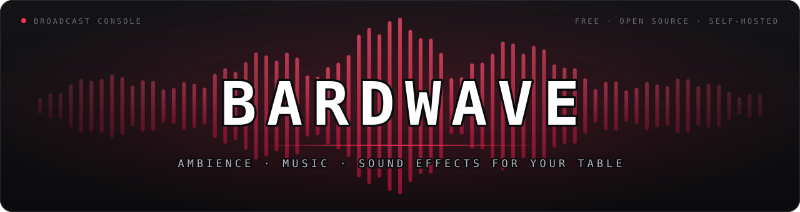
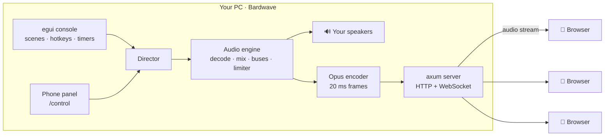

<!--
  Bardwave: free, open-source ambience for your table.
  Repo: https://github.com/adamantida/Bardwave
-->

<div align="center">



<br>

**Run the mix on your PC. Every player hears it in their browser.**<br>
No accounts. No subscriptions. No cloud. A self-hosted alternative to Syrinscape and RPG Sounds.

<br>

[](https://github.com/adamantida/Bardwave/actions/workflows/ci.yml)
[](LICENSE)
[](https://www.rust-lang.org)
[](#-quick-start)
[](#-contributing)

[**Quick start**](#-quick-start) ·
[**Features**](#-features) ·
[**Players & phone panel**](#-bring-your-players) ·
[**How it works**](#-how-it-works) ·
[**Docs**](#-documentation) ·
[**Roadmap**](#-status-and-roadmap)

</div>

<br>

> *A tavern taproom. A rain-soaked alley at midnight. The low drone before the dragon wakes.*
> You press one scene button. Four players on four different laptops hear exactly what you hear.
> No Discord screen-share, no shared folders, no "wait, send me that MP3 again".

<br>

## 🎲 Why Bardwave

Running ambience at a tabletop game is still awkward. Paid tools tie you to a subscription and their sound packs. Free ones make you share files, run a second voice channel, or host something in a cloud you do not control.

Bardwave takes the opposite route:

- 🗂 **Your library stays on your machine**: MP3, FLAC, OGG, WAV, AAC, or a YouTube link, whatever you already own.
- 🎛 **The mix is built live** on your desktop, not pre-rendered. You ride every fader while the scene plays.
- 🌐 **Players need only a browser.** They open one link and press *Establish Link*. Nothing to install, no account.
- 🔒 **Private by default.** An access key guards the stream, the audio goes straight from your PC to your players (no cloud in between), and the update check is opt-in.
- 🦀 **One native binary** written in Rust. No runtime, no Electron, no web view.

<br>

## ✨ Features

<table>
<tr>
<td width="50%" valign="top">

### 🎭 Scenes and crossfades
- A **scene** is a named set of sounds that starts with one click.
- **Crossfade** between scenes with equal-power or linear curves; switching mid-transition continues smoothly.
- **Save current mix as scene**: play by hand, press one button.
- **Stingers**: one-shot hits layered over everything, immune to scene changes.
- **Emitters**: random or periodic life (*crows every 20-60 s*) with jitter and overlap limits.

</td>
<td width="50%" valign="top">

### 🎼 Music and mix
- **Playlists** with shuffle, repeat and crossfade; a scene can own a music layer.
- **Long files are streamed** from disk, so an hour of music does not eat 1.4 GB of RAM.
- Three **buses** (music, ambience, sfx) with faders and **ducking** under a monologue.
- Optional **loudness normalization** (EBU R128), per-sound **pan**, peak limiter.

</td>
</tr>
<tr>
<td valign="top">

### ⌨️ Control
- **Hotkeys** for sounds, scenes, playlists, *Stop all* and ducking, in the window or system-wide (opt-in).
- **Timers**: *"activate the Alarm scene in ten minutes"*, *"bell stinger every half hour"*.
- **Phone panel** for the game master with its own key, a QR code and live sync across devices.
- **Stop all** silences everything at once.

</td>
<td valign="top">

### 📚 Library
- **Tags and search**, groups, recursive **folder import** with duplicate detection.
- **Missing files** are flagged, with relink and bulk path replace.
- **Bundles**: export or import scenes, playlists and sounds as one `.zip`.
- **YouTube import**: `yt-dlp` and `ffmpeg` fetch themselves on first use.
- **Profiles**: one library and config per campaign.

</td>
</tr>
<tr>
<td valign="top">

### 📡 Streaming
- The **final mix** goes out as 20 ms **Opus** frames (about 64 kbit/s) over WebSocket.
- The listener page is **embedded in the binary**; it reconnects by itself, shows link quality, keeps the phone awake and installs as a **PWA**.
- Live **now playing**: players see the scene and track name.
- Optional router port forwarding (**UPnP**) and optional **HTTPS**.

</td>
<td valign="top">

### 🎧 Audio and sessions
- Pick the **output device**, plus a separate **headphone device** for previews that never reach the players.
- **Record the session** to WAV (the mix players hear).
- **Live level meter**, listener counter, master volume.
- First-run **wizard**, interface scale, reduced-motion mode.

</td>
</tr>
</table>

<br>

## 🚀 Quick start

> **Prebuilt packages** (Windows installer and zip, macOS `.dmg`, Linux AppImage, `.deb` and tarball) are produced by CI whenever a release is cut. Until the first release is published, build from source; it takes one command.

```bash
git clone https://github.com/adamantida/Bardwave.git
cd Bardwave
cargo run --release
```

You need the [Rust toolchain](https://rustup.rs) 1.85 or newer and a sound card. On Linux, install `pkg-config libgtk-3-dev libasound2-dev libxkbcommon-dev libssl-dev` first.

Then, in the console:

1. **Add sounds.** Click **Add sound** or **Folder…**, or paste a link with **YouTube**. Group or tag them.
2. **Make a scene.** Start a few sounds, set the levels and press **Save mix as scene**.
3. **Go live.** Press **Start** in the SERVER panel and send your players the **Listen URL**.

The first-run wizard walks through the same three steps.

<details>
<summary><b>macOS, Linux and YouTube notes</b></summary>

- **macOS:** on the first **Start**, allow Bardwave to find devices on the local network, or LAN players cannot connect (*System Settings → Privacy & Security → Local Network*). Inside an `.app`, data lives in `~/Library/Application Support/Bardwave`. YouTube needs `brew install ffmpeg`.
- **Linux:** if a firewall is active, open port 8080. Global hotkeys work on X11 only. YouTube needs `apt install ffmpeg`.
- **Windows:** `yt-dlp` and `ffmpeg` download themselves on first use. The installer can add the firewall rule for you.
- **Headless:** `soundshared --server-only` runs without a window (see the [network guide](docs/en/network-remote.md)).

</details>

### 🛠 Build menu

Prefer a menu to remembering cargo commands? Run the build script:

```bash
./build.sh       # macOS and Linux
build.bat        # Windows
```

The menu can **run** the app, build **release** or **debug**, **check** everything (fmt, clippy, tests), **package** it (macOS: `.app`, universal `.dmg`, `.tar.gz`; Linux: `.tar.gz`, `.deb`, AppImage; Windows: portable `.zip`, Inno Setup installer, single `.exe`), pick a **target** platform, run a **doctor** that checks your toolchain and tells you how to install what is missing, and **clean** up. Artifacts land in `dist/` together with a `SHA256SUMS` file.

The same actions work without the menu, for scripts and CI:

```bash
./build.sh release                 # build.bat release
./build.sh package dmg             # build.bat package installer
./build.sh --dry-run package all   # print the commands without running them
./build.sh --help
```

> `build.sh` was run on macOS. `build.bat` has been reviewed but **not yet run on Windows**, so treat it as a preview.

<br>

## 👥 Bring your players

The SERVER panel shows the addresses to share:

| Address | Who uses it |
|---|---|
| `http://192.168.x.x:8080/?k=…` | **Your players**, on the same network. Click to copy. |
| `http://127.0.0.1:8080` | **You**, to test the listener page on your own PC. |
| `http://<public-ip>:8080/?k=…` | **Remote players.** Appears as *INTERNET* once the router forwards the port (UPnP). |

Players open the link and press **Establish Link**. On a phone they can add the page to the home screen.

**Drive the session from your phone.** The console also serves a mobile control page: scenes, stingers, faders, ducking, playlists and *Stop all*, live over WebSocket. It has its **own key**, separate from the players' key, and the console shows a QR code for it. The player key never opens it.

Behind a second NAT, a VPN, or a strict firewall? See the [troubleshooting guide](docs/en/troubleshooting-security.md).

<br>

## 🧠 How it works



- **One control core.** The window, the hotkeys, the timers and the phone panel all go through the same `Director`, so they always agree on what is playing.
- **Typed commands.** The GUI, the audio engine and the network talk through typed channels, not shared mutable state.
- **Real-time rules.** The audio callback only mixes: no allocation, no I/O, no long locks. The render thread never blocks.
- **Rust all the way.** Symphonia decodes, `cpal` plays, and Opus is pure Rust (`rusty-opus`), so there is no CMake or C toolchain to build.

Modules, threading model, wire protocol and testing are described in the [developer guide](docs/en/developer.md).

<br>

## 🔒 Security in 30 seconds

| | Player key | GM key |
|---|---|---|
| Config key | `server.access_token` | `server.gm_token` |
| Opens | the audio stream | the phone panel and its API |
| Give it to | players | nobody but yourself |
| Rotate | button next to **Access key** | **New key** next to the GM link |

- The GM link looks like `http://<address>:<port>/control?g=<gm_token>`. The player key never opens it, and `gm_token = ""` in `config.toml` switches remote control **off** (the panel then answers on your PC only).
- Plain HTTP is fine on your home network. Over the internet, turn on **HTTPS** (a separate, off-by-default setting, with a self-signed or your own certificate) or use a VPN: see the [HTTPS guide](docs/en/https.md).
- A stock install makes **no network requests** on its own. The update check is a button, off by default.

<br>

## 📖 Documentation

Full guides in three languages:

| Guide | English | Русский | 简体中文 |
|---|---|---|---|
| Getting started | [read](docs/en/getting-started.md) | [читать](docs/ru/getting-started.md) | [阅读](docs/zh/getting-started.md) |
| Sound library | [read](docs/en/soundboard-library.md) | [читать](docs/ru/soundboard-library.md) | [阅读](docs/zh/soundboard-library.md) |
| Scenes, music and hotkeys | [read](docs/en/scenes-music-hotkeys.md) | [читать](docs/ru/scenes-music-hotkeys.md) | [阅读](docs/zh/scenes-music-hotkeys.md) |
| Audio devices, recording, profiles | [read](docs/en/audio-session-tools.md) | [читать](docs/ru/audio-session-tools.md) | [阅读](docs/zh/audio-session-tools.md) |
| Network, players and phone panel | [read](docs/en/network-remote.md) | [читать](docs/ru/network-remote.md) | [阅读](docs/zh/network-remote.md) |
| HTTPS | [read](docs/en/https.md) | [читать](docs/ru/https.md) | [阅读](docs/zh/https.md) |
| Configuration reference | [read](docs/en/configuration.md) | [читать](docs/ru/configuration.md) | [阅读](docs/zh/configuration.md) |
| Troubleshooting, FAQ, security | [read](docs/en/troubleshooting-security.md) | [читать](docs/ru/troubleshooting-security.md) | [阅读](docs/zh/troubleshooting-security.md) |
| Developer guide | [read](docs/en/developer.md) | [читать](docs/ru/developer.md) | [阅读](docs/zh/developer.md) |

Terminology for the translations: [docs/GLOSSARY.md](docs/GLOSSARY.md). Everything that changed since v1.4.0 is in the [CHANGELOG](CHANGELOG.md).

<br>

## 🗺 Status and roadmap

Bardwave is **young software**: the core is tested (over a thousand automated tests, CI on Linux, Windows and macOS), but parts have never run on real machines yet.

**Not verified on real hardware:** `build.bat`, the Windows installer and the Linux packages, the macOS `.app`/`.dmg` and signing, system-wide hotkeys on macOS, MIDI, UPnP across router models, the listener page on iOS Safari and Android Chrome, and HTTPS with a real phone. Details are in the [troubleshooting guide](docs/en/troubleshooting-security.md). If you try any of them, a bug report with your OS version is very welcome.

- [x] Scenes, crossfades, stingers, emitters, timers, playlists with streaming
- [x] Hotkeys, phone panel with its own key and QR, tags and search, bundles, profiles
- [x] Ducking, buses, normalization, pan, output and headphone devices, session recording
- [x] PWA listener page, optional HTTPS, packaging scripts and workflows
- [ ] Verify installers, macOS app and system-wide hotkeys on real machines
- [ ] Connect MIDI controllers to the console (the module exists but is not wired in)
- [ ] Code-signed Windows build and a signed, notarized macOS build
- [ ] A light theme (the palette is constants today, so it needs a separate rework)
- [ ] Separate music and effects volume for players (needs separate streams)

<br>

## 🤝 Contributing

Ideas, bug reports and pull requests are welcome.

- Open an issue describing the bug or feature before a large PR.
- Keep the console buildable and the tests green:

  ```bash
  cargo fmt --all --check
  cargo clippy --all-targets -- -D warnings
  cargo test --all-targets
  ```

- Match the style: typed commands over shared state, no blocking work on the render thread, nothing in the audio callback beyond mixing.

Build, test, packaging and release details live in the [developer guide](docs/en/developer.md).

<br>

## 📄 License

[MIT](LICENSE) © 2026 adamantida

Bardwave is not affiliated with, endorsed by, or sponsored by Syrinscape, RPG Sounds, or Wizards of the Coast. Those names are mentioned only to describe what this project is an alternative to. D&D, Pathfinder and other game systems are trademarks of their respective owners.
